# Delivery workflow

```mermaid
flowchart LR
  C["/speckit-constitution · principles<br/>make check-constitution gates the coverage"]
  S["/speckit-specify · whole product"]
  Q["/speckit-clarify · answers back into spec.md"]
  CK["/speckit-checklist · checklists/"]
  GS["find-gaps survey · read-only"]
  G["/gaps conversation · confirmed answers into spec.md"]
  EMOD(["event-modeling · events, commands, read models, actors"])
  SS["/story-splitting · slices"]

  subgraph loop["once per slice — /sail owns the loop, repeating until the split is exhausted"]
    direction TB
    EM["/example-map · rules → examples → GWT"]
    EG["/gaps · tighten examples.md, on paper"]
    P["/speckit-plan · one slice"]
    T["/speckit-tasks · one slice"]
    AN["/speckit-analyze · spec, plan and tasks agree"]
    I["/speckit-implement · RED → GREEN → REFACTOR"]
    CV{"/speckit-converge · is everything the artifacts require built?"}
    DG["/gaps · promise → test → production path"]
    D{"demo · actor-visible path"}
    A["/adversary · only when the surface changed, or the split closed"]
    M["/mutation · measure the suite"]
    EM --> EG --> P --> T --> AN --> I --> CV
    CV -->|"appends tasks"| I
    CV -->|"converged"| DG --> D
    D -->|"accepted · new attack surface"| A --> M
    D -->|"accepted · surface already in the log"| M
    D -.->|"feedback changes behaviour"| EM
    D -.->|"feedback changes implementation"| I
  end

  C --> S --> Q
  Q --> CK --> G
  Q --> GS --> G
  G --> EMOD --> SS --> EM

  G -.->|"gap found"| S
  EM -.->|"map reveals more than one slice"| SS
  P -.->|"title still says 'and'"| SS
  M -.->|"next ready slice"| EM
  EM -.->|"an event has no name"| EMOD
  D -.->|"feedback changes slice"| SS
  D -.->|"feedback changes event contract"| EMOD
  D -.->|"feedback changes product scope"| S
```

<!-- section: event-diagram -->

<!-- end section -->
<!-- section: plain-diagram -->

<!-- end section -->

```mermaid
flowchart LR
  C["/speckit-constitution · principles<br/>make check-constitution gates the coverage"]
  S["/speckit-specify · whole product"]
  Q["/speckit-clarify · answers back into spec.md"]
  CK["/speckit-checklist · checklists/"]
  GS["find-gaps survey · read-only"]
  G["/gaps conversation · confirmed answers into spec.md"]
  SS["/story-splitting · slices"]

  subgraph loop["once per slice — /sail owns the loop, repeating until the split is exhausted"]
    direction TB
    SG["/gaps · tighten the slice's criteria, on paper"]
    P["/speckit-plan · one slice"]
    T["/speckit-tasks · one slice"]
    AN["/speckit-analyze · spec, plan and tasks agree"]
    I["/speckit-implement · RED → GREEN → REFACTOR"]
    CV{"/speckit-converge · is everything the artifacts require built?"}
    DG["/gaps · promise → test → production path"]
    D{"demo · actor-visible path"}
    A["/adversary · only when the surface changed, or the split closed"]
    M["/mutation · measure the suite"]
    SG --> P --> T --> AN --> I --> CV
    CV -->|"appends tasks"| I
    CV -->|"converged"| DG --> D
    D -->|"accepted · new attack surface"| A --> M
    D -->|"accepted · surface already in the log"| M
    D -.->|"feedback changes implementation"| I
  end

  C --> S --> Q
  Q --> CK --> G
  Q --> GS --> G
  G --> SS --> SG

  G -.->|"gap found"| S
  P -.->|"title still says 'and'"| SS
  M -.->|"next ready slice"| SG
  D -.->|"feedback changes slice"| SS
  D -.->|"feedback changes behaviour"| S
```

For one small vertical slice:

1. {{discovery}}.
2. On the specification, run `/speckit-clarify`. Against that clarified snapshot, run
   `/speckit-checklist` and the read-only find-gaps survey in parallel. When both return, run the find-gaps
   conversation on the host, using both outputs and writing confirmed answers back while a missing state
   is still a paper edit. On a slice's example map or its own criteria, `/gaps` is the whole pass.
3. Create or resume `plan.md` and `tasks.md` with the Spec Kit commands installed by `./init`.
4. Run `/speckit-analyze` over `spec.md`, `plan.md` and `tasks.md`. It writes nothing. A finding goes back
   to the plan or the tasks; a clean reading is what lets implementation start.
5. Implement each task RED-GREEN-REFACTOR, keeping `make verify` green.
6. Run the installed Spec Kit converge command, implement whatever it appends, and repeat until it reports
   converged or reaches its bound.
7. Prove every example in the slice's `examples.md` with a passing test, and review the slice's diff once.
8. Run `/adversary` — it attacks the slice where it widened identity, authority or money and otherwise
   defers to the capability — then `make verify`, and merge.
9. Once a capability's last slice has merged, run its gates once: converge over its diff, `/gaps`, the design
   review from screenshots, one adversary pass, `/mutation`, and the hand's walk of every example. Then the
   person's demo. Under the `open` release mode the gaps trace, the design review and the walk run per slice,
   at steps 6 to 8, instead, and every slice the adversary table owes is attacked; the capability's converge,
   adversary pass and mutation still run.

The principles stage has a gate of its own. `.specify/memory/constitution.md` is what every stage after it
treats as the authority, so `make check-constitution` fails the build when that file stops carrying minimum
CD, the practices the skills in `skills/` teach, or the obligations this project's capabilities claim — and
`.specify/extensions.yml` hooks `/speckit-constitution` on both sides so the drafting session sees the
required coverage before writing and the check runs immediately after. `/constitution-coverage` prints the
normative text at any time. Until that stage has been started the gate stands aside: `./init` installs the
template, and the untouched template passes, so the walking skeleton reaches `main` — and production, where
there is a target — before the first principle is written. It applies from the first edit, and from the first
feature under `specs/` whether or not the constitution was touched.

**Analyze** is the read between tasks and implementation. It compares `spec.md`, `plan.md` and `tasks.md`
and writes nothing, so a plan that has drifted is caught before any code. It is not either `/gaps` pass:
the one before planning tightens a single artifact, and the capability's one after converge traces a promise
to a test and a path.

Three stages in the loop are deliberately not the shape they look like. **Converge** is append-only — its
only write is new tasks — so it is safe to repeat until it reports converged or reaches its bound, and it is what makes the demo
worth showing. The **second `/gaps`** runs once per capability, after every slice under it converged,
because ahead of converge every unbuilt task reads as a gap, and slice by slice a promise two slices keep
between them reads as one neither kept. **`/adversary`** is an end-of-phase pass rather than a
per-increment one: per slice `commands/adversary.md` attacks only a widened identity, authority or money
surface and defers the rest to the capability's one pass, and records the decision either way in
`specs/<feature>/adversary-log.md` — which is what lets a later slice decline on evidence instead of
judgement. The trigger table is in that row before any spawn. **`/mutation`** runs once per capability — when its last
slice has merged, before the person is shown it, bounded by its budget and leaving a qualified receipt rather
than a score when capped — and when both run adversary goes first, since it
adds tests and mutation measures whatever exists when it runs.

`/sail` owns resumption and sequencing, and is safe to call at any point on this diagram: it enters at the
first stage still owing an artifact, stepping back out of the loop when an upstream stage has not been done.
Demo feedback returns to the stage that owns the change before the path is demonstrated again. A real product decision is a stop; finishing an intermediate document is
not.

`/cruise` runs this same diagram with nobody at the wheel. A product decision is answered by `sail-decide-skipper`
and written in `specs/<feature>/decisions.md`; the hand's walk is run by `sail-demo-hand` and written in the
capability's `demo-log.md`; the run ends only when the specification is satisfied, or when a person stops it. What each
stage produces does not change. `commands/cruise.md` is exact.
